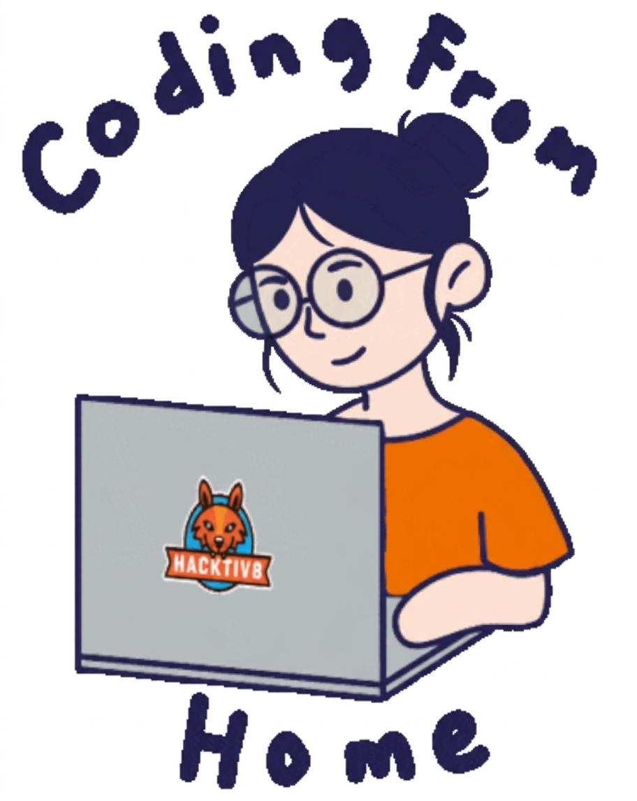

<!-- Header Section -->
<h1 align="center">👋 Hello Coders</h1>
<h3 align="center">💻 Computer Science Student | 🚀 Python & AI/ML Enthusiast</h3>

<!-- Animated GIF -->

  

<!-- Typing Animation -->

 

<!-- Divider -->

  

## 🛠️ Tech Stack & Tools

### 💻 Programming Languages

  

### 🌐 Web Development

  

### 🤖 Data, AI & Analytics

  
  
  
  

### ⚙️ Tools, Platforms & Databases

  

### 📊 Office & Productivity

  
  
  

## 📫 Connect With Me

  
  <!-- LinkedIn -->
  <!-- Header Section -->
<h1 align="center">👋 Hello Coders</h1>
<h3 align="center">💻 Computer Science Student | 🚀 Python & AI/ML Enthusiast</h3>

<!-- Animated GIF -->

  

<!-- Typing Animation -->

 

<!-- Divider -->

  

## 🛠️ Tech Stack & Tools

### 💻 Programming Languages

  

### 🌐 Web Development

  

### 🤖 Data, AI & Analytics

  
  
  
  

### ⚙️ Tools, Platforms & Databases

  

### 📊 Office & Productivity

  
  
  

## 📫 Connect With Me

  
  <!-- LinkedIn -->
  
  
  <!-- Portfolio -->
  
  
  <!-- Email -->
  
  
  <!-- GitHub -->
  
    

---

## Contribution Graph

  <picture>
    <source media="(prefers-color-scheme: dark)" srcset="https://raw.githubusercontent.com/deepsha-3/deepsha-3/output/github-contribution-grid-snake-dark.svg">
    <source media="(prefers-color-scheme: light)" srcset="https://raw.githubusercontent.com/deepsha-3/deepsha-3/output/github-contribution-grid-snake.svg">
    
  </picture>

---

## 💭 Daily Motivation

   
  <i>💡 Tip: Consistency beats intensity and motivation.  Code a little every day!</i>

---
  
  <!-- Portfolio -->
  
  
  <!-- Email -->
  
  
  <!-- GitHub -->
  
    

---

## Contribution Graph

  

---

## 💭 Daily Motivation

   
  <i>💡 Tip: Consistency beats intensity and motivation.  Code a little every day!</i>

---
